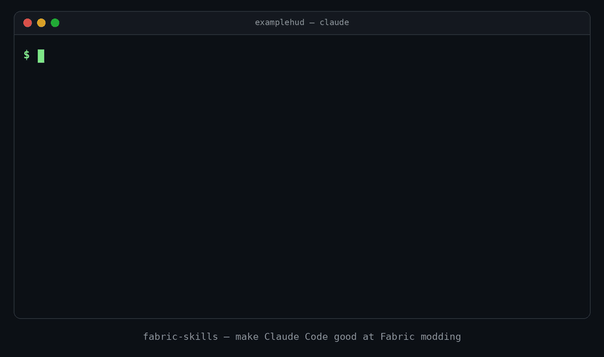

<div align="center">

# fabric-skills

**Make Claude Code actually good at Minecraft Fabric modding.**

[](LICENSE)
[](https://github.com/vvs1off/fabric-skills/actions/workflows/validate-skills.yml)
[](https://github.com/vvs1off/fabric-skills/actions/workflows/build-example.yml)
[](https://github.com/vvs1off/fabric-skills/actions/workflows/gitleaks.yml)
[](https://github.com/vvs1off/fabric-skills/releases)
[](#which-minecraft-versions)

</div>

<!-- TODO(maintainer): record a short demo (e.g. /fabric-skills:new -> working HUD mod) and save it as docs/demo.gif -->
<p align="center">
  
</p>

AI coding agents write Fabric code from memory, and that memory is stale. Fabric changed more
in the last year than in the five before it: Minecraft 26.1 dropped obfuscation and Yarn, Loom
got a new plugin id, Fabric API renamed hundreds of classes, and 26.3 even swapped GLFW for SDL.
The result: mods that don't compile, mixins that silently do nothing, and HUDs that crash
dedicated servers.

**fabric-skills** is a Claude Code plugin that teaches the agent how Fabric modding works
*today*, how to detect which version a project is on, and where to look things up instead of
guessing.

## Install

In Claude Code:

```
/plugin marketplace add vvs1off/fabric-skills
/plugin install fabric-skills@fabric-skills
```

That's it. The skills load automatically when you work on a Fabric mod. Run `/reload-plugins`
(or restart Claude Code) if you installed it mid-session.

## What's inside

### Skills (loaded automatically when relevant)

| Skill | What it teaches the agent |
|---|---|
| [`fabric-project-setup`](skills/fabric-project-setup/SKILL.md) | `build.gradle`, `gradle.properties`, `fabric.mod.json`, entrypoints, mixin configs, client/common source split, and how to tell the **26.1+ unobfuscated era** from the **Yarn/remapping era** |
| [`fabric-mixins`](skills/fabric-mixins/SKILL.md) | When *not* to write a mixin, `@Inject`, MixinExtras (`@WrapOperation`, `@ModifyExpressionValue`, `@Local`), accessors/invokers, class tweakers, cross-mod compatibility, `mixin.debug.export` |
| [`fabric-client-rendering`](skills/fabric-client-rendering/SKILL.md) | HUD elements per version (`HudElementRegistry` vs older callbacks), `GuiGraphicsExtractor`/`GuiGraphics`/`DrawContext`, ARGB colours, tooltips, screens, zero-allocation render loops |
| [`fabric-networking`](skills/fabric-networking/SKILL.md) | `CustomPacketPayload` + `StreamCodec`, payload registration on both sides, server-side validation checklist, `PlayerLookup`, `canSend` |
| [`fabric-config-and-keybinds`](skills/fabric-config-and-keybinds/SKILL.md) | `KeyMappingHelper` / `KeyBindingHelper`, SDL vs GLFW key codes, dependency-free JSON config, YACL / Cloth Config, Mod Menu as a soft dependency |
| [`fabric-version-porting`](skills/fabric-version-porting/SKILL.md) | A step-by-step porting process, Yarn -> Mojang migration, where to read changelogs, rename tables for Fabric API and vanilla |
| [`fabric-crash-debugging`](skills/fabric-crash-debugging/SKILL.md) | Reading crash reports and `latest.log`, decoding Mixin errors, dependency resolution failures, client/server class-loading crashes, Gradle/Loom failures |
| [`fabric-release`](skills/fabric-release/SKILL.md) | SemVer + Minecraft build metadata, changelogs, reproducible jars, publishing to Modrinth / CurseForge / GitHub from Actions with tokens only in Secrets |

### Commands

| Command | What it does |
|---|---|
| `/fabric-skills:new [name]` | Asks for name, mod id, Minecraft version and client-only, looks up current versions, scaffolds the project and builds it until it passes |
| `/fabric-skills:port <version>` | Analyses the mod, shows a porting plan, then ports it in reviewable commits and loops on `./gradlew build` until it works |
| `/fabric-skills:check [path]` | Read-only audit of `fabric.mod.json`, build setup, dependencies, mixins, client/server separation and secrets, as a prioritized report |

### Agent

| Agent | What it does |
|---|---|
| `mixin-reviewer` | Reviews every mixin for wrong targets, fragile injection points, conflicts with other mods (Sodium, Iris, Lithium...) and safer alternatives. Read-only. |

### Example mod

[`examples/example-mod`](examples/example-mod) is a minimal client-side mod for the latest
stable Minecraft that follows every rule in the skills: a coordinates HUD element, a key that
toggles it, one MixinExtras mixin and a JSON config. CI builds it on every change.

## Before / after

**Prompt:** *"Add a HUD that shows my coordinates, toggled with H."* (project on Minecraft 26.3)

<table>
<tr><th>Without the plugin</th><th>With fabric-skills</th></tr>
<tr><td>

```java
// build.gradle: id 'fabric-loom', mappings yarn...
public class ExampleModClient implements ClientModInitializer {
  KeyBinding key = KeyBindingHelper.registerKeyBinding(
    new KeyBinding("key.examplemod.toggle",
      InputUtil.Type.KEYSYM, GLFW.GLFW_KEY_H,
      "category.examplemod"));

  public void onInitializeClient() {
    HudRenderCallback.EVENT.register((ctx, tick) -> {
      var p = MinecraftClient.getInstance().player;
      ctx.drawText(MinecraftClient.getInstance()
          .textRenderer, String.format("%d %d %d",
          p.getBlockX(), p.getBlockY(), p.getBlockZ()),
          4, 4, 0xFFFFFF, true);
    });
  }
}
```

</td><td>

```java
// build.gradle: id 'net.fabricmc.fabric-loom', no mappings
toggle = KeyMappingHelper.registerKeyMapping(new KeyMapping(
    "key.examplemod.toggle_hud",
    InputConstants.Type.KEYBOARD, InputConstants.KEY_H,
    KeyMapping.Category.register(ExampleMod.id("main"))));

HudElementRegistry.attachElementAfter(
    VanillaHudElements.HOTBAR, ExampleMod.id("coords"),
    CoordinatesHud::extract);

// CoordinatesHud.extract(GuiGraphicsExtractor g, DeltaTracker d):
if (!cfg.hudEnabled || mc.player == null
        || mc.gui.hud.isHidden()) return;
g.text(mc.font, cachedText, x, y, 0xFFFFFFFF, true);
// cachedText is rebuilt in END_CLIENT_TICK only when
// the block position changes: no per-frame allocation
```

</td></tr>
<tr><td>

- Yarn names and a `mappings` line on an unobfuscated version: **does not compile**
- `KEYSYM` and `GLFW` no longer exist on 26.3
- Deprecated HUD callback
- `0xFFFFFF` is fully transparent since 1.21.6, so the text is **invisible**
- NPE on the title screen, `String.format` every frame, ignores F1

</td><td>

- Right Loom plugin and APIs for the detected version
- ARGB colour, null-safe, respects F1
- Allocation-free render path
- Translation keys instead of hardcoded strings
- Builds on the first try

</td></tr>
</table>

## Example prompts

```text
Create a client-only Fabric mod that shows a compass bar at the top of the screen.
```
```text
/fabric-skills:new Better Pings
```
```text
/fabric-skills:port 26.3
```
```text
My dedicated server crashes on startup with "Cannot load class net.minecraft.client.Minecraft
in environment type SERVER". Here's the log: ...
```
```text
Add a packet so that pressing G pings the block I'm looking at for nearby players.
Validate everything on the server.
```
```text
Review my mixins for compatibility with Sodium and Lithium.
```
```text
/fabric-skills:check
```
```text
Set up a GitHub Actions release that publishes to Modrinth when I push a tag.
```

## Which Minecraft versions?

The skills **never hardcode version numbers** for you to copy. They tell the agent to look up
the current Minecraft, Fabric Loader, Loom and Fabric API versions on
[fabricmc.net/develop](https://fabricmc.net/develop/) and
[meta.fabricmc.net](https://meta.fabricmc.net/), and to verify names in the decompiled sources
of *your* version.

They cover both eras explicitly:

- **Minecraft 26.1 and newer**: unobfuscated, Mojang names, `net.fabricmc.fabric-loom`, no
  mappings (examples verified against 26.3).
- **Minecraft 1.20.x - 1.21.11**: remapping Loom with Yarn or Mojang mappings, with the
  differences called out wherever an API changed.

## How it works

Each skill is a Markdown file with a `description` that tells Claude *when* to load it. When
you ask about a HUD, a crash, a packet or a port, Claude Code loads the matching skill and
follows it: detect the project's era, look up current versions, check names in generated
sources, write the code, and avoid the listed common mistakes. The commands chain those skills
into complete workflows, and the agent provides an independent second opinion on mixins.

## Roadmap

- [ ] NeoForge support (skills + detection of multi-loader projects)
- [ ] Architectury / multi-loader setups
- [ ] Meteor Client addon skill
- [ ] More skills: data generation, blocks & block entities, entities, world rendering,
      game tests, commands
- [ ] Multi-version projects (Stonecutter)
- [ ] Plugin evals that check the agent's output compiles against real versions
- [ ] A recorded demo GIF

Ideas and requests are welcome in [issues](https://github.com/vvs1off/fabric-skills/issues).

## Contributing

Contributions are very welcome, especially corrections when Fabric or Minecraft changes an
API. Read [CONTRIBUTING.md](CONTRIBUTING.md) for the skill format, how to verify code against
real sources, and how to run the checks locally. Security issues: see [SECURITY.md](SECURITY.md).

## License

[MIT](LICENSE). Not affiliated with Mojang, Microsoft, FabricMC or Anthropic. Minecraft is a
trademark of Mojang Synergies AB.
